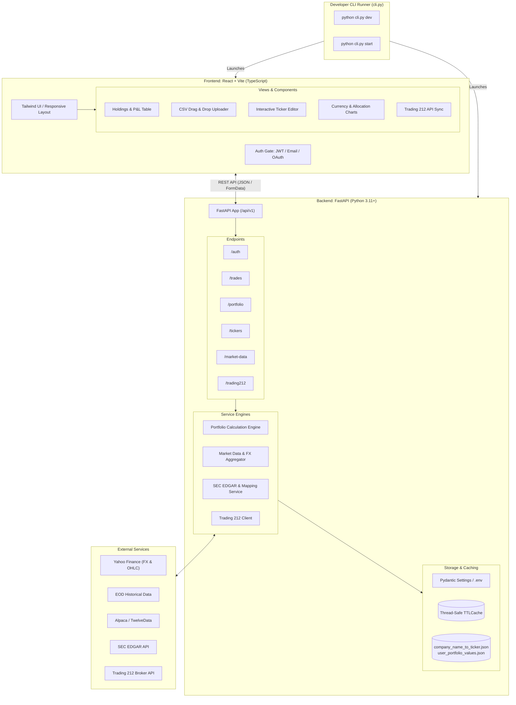

# st-my-investment2: Portfolio Management & Analytics

[](https://kaizhang.atlassian.net/browse/KAN-3)
[](https://kaizhang.atlassian.net/wiki/spaces/LC/pages/1409056769)

## 📌 Architecture Overview (KAN-3: De-Streamlit)
This repository hosts the **Portfolio Management Dashboard and Analytics** application. As specified in **[KAN-3](https://kaizhang.atlassian.net/browse/KAN-3)**, the monolithic Streamlit architecture has been refactored into a decoupled, modern Web Application:
- **Frontend:** React 18, Vite, TypeScript, and Tailwind CSS.
- **Backend:** Python 3.11+ FastAPI REST API with Pydantic v2 schemas and modular service engines.
- **Local Dev Workflow:** Python CLI runner (`cli.py`) inspired by the CV-creator pattern.

For complete technical specifications, see the **[Confluence Architecture & Technical Design Page](https://kaizhang.atlassian.net/wiki/spaces/LC/pages/1409056769)**.

---

## 🏛 System Architecture



---

## 🚀 Quickstart & Developer Guide

### 1. Prerequisites
- Python 3.10+
- Node.js 18+ and npm

### 2. Environment Setup
Copy the example environment configuration:
```bash
cp backend/.env.example backend/.env
```
*(No secrets are committed to git)*

### 3. Running Locally (CLI Runner)
Using the unified CLI runner:
```bash
# Start development environment (FastAPI on :8000 + Vite on :5173 with auto-reload)
python cli.py dev

# Serve the production build directly from FastAPI on port 8000
python cli.py start
```

---

## 📂 Project Structure
```
├── cli.py                     # Root CLI runner (CV-creator pattern)
├── backend/                   # FastAPI application
│   ├── app/
│   │   ├── main.py            # FastAPI entry & router registration
│   │   ├── core/              # Config (Pydantic BaseSettings), security, cache
│   │   ├── api/v1/            # Auth, trades, portfolio, tickers, market-data, trading212
│   │   ├── schemas/           # Pydantic v2 validation models
│   │   └── services/          # Pure calculation engines & API wrappers
│   ├── requirements.txt       # Backend dependencies
│   └── .env.example           # Configuration template
├── frontend/                  # React Single Page Application
│   ├── src/
│   │   ├── components/        # Layout, auth, dashboard, trades, tickers, trading212
│   │   ├── hooks/             # Zustand auth store & custom hooks
│   │   ├── services/          # Axios API client
│   │   └── types/             # TypeScript interfaces
│   ├── package.json           # Frontend dependencies
│   └── vite.config.ts         # Vite build & proxy configuration
└── company_name_to_ticker.json# Broker market name to Yahoo ticker mappings
```

---

## 📖 Detailed Specifications
- **Confluence Design Document:** [st-my-investment2: Web Architecture & Technical Design (KAN-3)](https://kaizhang.atlassian.net/wiki/spaces/LC/pages/1409056769)
- **Jira Story:** [KAN-3](https://kaizhang.atlassian.net/browse/KAN-3)

