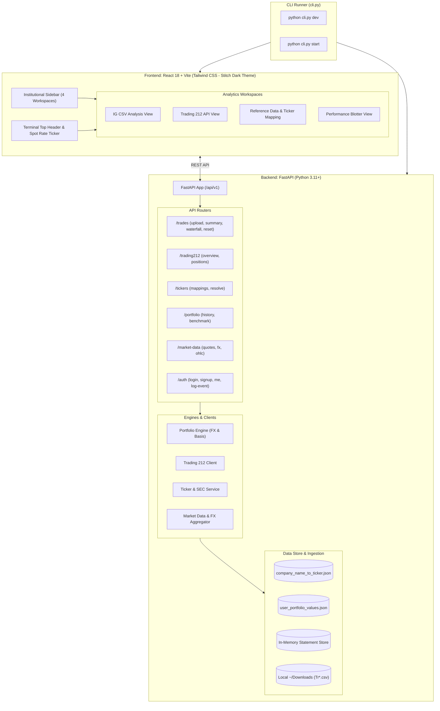

# st-my-investment2: Portfolio Management & Analytics

[](https://kaizhang.atlassian.net/browse/KAN-3)
[](https://kaizhang.atlassian.net/browse/KAN-6)
[](https://kaizhang.atlassian.net/wiki/spaces/LC/pages/1409056769)

## 📌 Architecture Overview

This repository hosts the **Portfolio Management Dashboard and Analytics** application. Originally built as a monolithic Streamlit application, it has transitioned to a modern, decoupled web architecture:
- **Frontend:** Single Page Application (SPA) built with React 18, Vite, TypeScript, and Tailwind CSS.
- **UI/UX Design (KAN-6):** High-fidelity, institutional dark financial terminal styled and redesigned using **Google Stitch** (Project: *Kai Family Office*, ID: `12026627589197832258`). Provides a streamlined, direct-to-workspace layout without blocking login hurdles for prototyping.
- **Backend:** High-performance RESTful API built with Python 3.11+, FastAPI, and Pydantic v2.
- **Smart Statement Ingestion & Local Autoload:** Automatically inspects the local environment (`~/Downloads/Tr*.csv`) for the latest real IG statements before falling back to sample data.
- **Local Dev Workflow:** Unified Python CLI runner (`cli.py`) enabling one-command local launching of both services.
- **Decoupled Login for Prototyping:** Local development directly opens the active terminal workspaces without requiring authentication gates.

---

## 🏛 System Architecture & Workspaces

The application features four institutional workspaces accessible via the persistent sidebar:

1. **IG CSV Analysis (`/` - default view):**
   - **Local File Auto-Discovery:** Scans `~/Downloads` for `Tr*.csv` statements (`TradeHistory-*.csv` and `TransactionHistory-*.csv`), parses filename date ranges or modification timestamps, and auto-loads the latest statement. Safely falls back to the institutional sample ledger only if no local statements exist.
   - Drag-and-drop ingestion deck for manual uploading of IG Broker statements (`Trade*.csv` and `Transaction*.csv`).
   - Consolidated portfolio telemetry (Total Market Value, Cash Buffer, Cost Basis, Unrealized P&L).
   - Real-time holdings ledger with 7-day trend sparklines, exchange taxonomy, and P&L color coding.
   - Currency & sector allocation donut chart (USD, GBP, EUR exposure).
   - Single Instrument Inspector with interactive ticker switcher, execution markers (Buys/Sells), and trade fill history.
   - Recent quarters trade activity blotter with `ALL`, `BUYS`, and `SELLS` quick filters populated from parsed statements.
   - Cashflow waterfall breakdown (dividends, cash interest, broker commissions, stamp duty).
   - One-click panel reset (`POST /api/v1/trades/reset`) to purge in-memory cache and re-scan for fresh local statement files.

2. **Trading 212 API Workspace:**
   - Pure REST API integration using direct header authentication (`x-t212-key`, `x-t212-secret`).
   - 7 Bloomberg-dense telemetry cards (Value, Cash, Investments, Cost, Realised P&L, FX Impact, Unrealised P&L).
   - Live open positions blotter with spread, average buy price, and % portfolio weight.
   - Currency exposure donut and FX risk alert callout.
   - Order history and execution blotter with filled status.
   - Dividends blotter & income telemetry with yield-on-cost and projected run-rate.

3. **Reference Data & Ticker Mapping Editor:**
   - Active symbology master table (`CSV Raw String / Broker Feed` ➔ `Yahoo Ticker`).
   - Direct persistence to `company_name_to_ticker.json` on disk via FastAPI PUT endpoint.
   - Ingestion reconciliation engine with SEC EDGAR auto-resolver for unmapped symbols.
   - Live syntax-highlighted JSON store inspector.

4. **Performance Blotter:**
   - Consolidated portfolio equity curve over time from historical ledger accounts.
   - S&P 500 benchmark overlay.
   - Risk & return telemetry (Sharpe ratio, max drawdown, annualized volatility, win rate).



---

## 🚀 Quickstart & Developer Guide

### 1. Prerequisites
- Python 3.10+
- Node.js 18+ and npm

### 2. Environment Setup
```bash
# Backend environment variables
cp backend/.env.example backend/.env

# Local secrets & Stitch MCP API Key (gitignored)
cp .env.example .env
```

### 3. Running Locally

```bash
# Option A: Start development mode (FastAPI on :8000 + Vite on :5173 with auto-reload)
python cli.py dev

# Option B: Serve the production build directly from FastAPI on port 8000
python cli.py start
```

### 4. Building Frontend Assets
```bash
cd frontend
npm install
npm run build
```

---

## 🎨 Google Stitch Redesign (KAN-6)

As part of **[KAN-6](https://kaizhang.atlassian.net/browse/KAN-6)**, the UI was rebuilt into a dark-mode institutional trading terminal using Google Stitch:
- **Direct Workspace Navigation:** Bypasses login gates for rapid local prototyping while keeping JWT and Firebase auth endpoints available.
- **Dynamic Telemetry & Live Data Binding:** Replaced static placeholders with reactive summaries calculated from ingested broker statements.
- **Local Download Auto-Detection:** Seamless transition from mock preview to user's real portfolio by checking `~/Downloads/Tr*.csv` on startup.

---

## 🔌 Google Stitch MCP Integration

Google Stitch MCP provides AI-native design system and screen management tools directly through Model Context Protocol.

- **Endpoint:** `https://stitch.googleapis.com/mcp`
- **Transport:** HTTP JSON-RPC
- **Project Name:** Kai Family Office (`projects/12026627589197832258`)
- **Key Screens:**
  - `KAI Family Office Investment Dashboard` (`fdea23702f7f4d8b81ec716feea03a80`)
  - `Trading 212 API Portfolio Analysis` (`06a65981fac64ce9acc6f5276b495df1`)
  - `Reference Data & Ticker Mapping Editor` (`c2abfb97bc114db0a9ac72cdececda1e`)

---


## 📖 Specifications & Tracking
- **Jira Story (Frontend Redesign):** [KAN-6: Frontend redesign without login page](https://kaizhang.atlassian.net/browse/KAN-6)
- **Jira Story (Architecture):** [KAN-3: propose new design and architecture](https://kaizhang.atlassian.net/browse/KAN-3)
- **Confluence Architecture Page:** [st-my-investment2: Web Architecture & Technical Design (KAN-3)](https://kaizhang.atlassian.net/wiki/spaces/LC/pages/1409056769)
